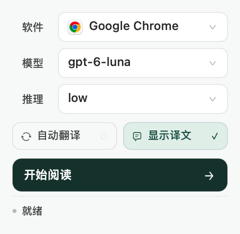
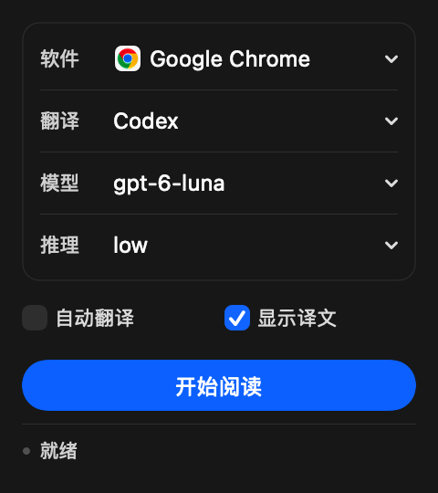

# Shiori

日语漫画翻译，常驻 macOS 菜单栏。

选择正在使用的软件和翻译服务，点「开始阅读」。Google 直接翻译，Codex 可选模型和推理。翻页后自动识字、翻译并回填原位置；按住 ⌥ 可临时查看原图。

- 保留竖排，连体气泡分别排字，译文随返回逐步显示。
- 局部疑点先比对并重识；仍有缺字时用小号灰色 `□`，可读部分继续翻译。整句无法辨认则保留原图，底部统一显示待确认数量。
- 补识别气泡外的拟声词；复杂背景用本地 LaMa 修复，纯色区域直接回填。
- 右键菜单栏图标 →「修正气泡…」，点选气泡后可重新识字、修改原文与译文、重新翻译或恢复原图。按 Esc 退出选择。
- 手动修正保存在当前页，后续补译会保留；整页重新翻译或重新识字时重新生成。
- 识字和背景修复在本地完成，翻译服务只接收文字。Codex 使用已登录的 ChatGPT 账号；Google 无需 API Key。
- 自动阅读绑定当前窗口和网页；切换软件或离开该页时暂停处理，返回后继续。支持同章翻页。
- 可靠气泡先识字、翻译和显示，Vision 在后台补漏与复核；复杂背景修复同时进行，完成后补齐。
- 同页复用缓存，翻页取消旧任务并保留连接；缺失条目补译一次。
- 缓存合计上限 258 MiB。近期两页文字用于人名和语气衔接，关闭后清空。

Google 通过网页翻译服务连接，速度受网络影响；上下文较强的对白可切换 Codex。

首次使用需要录屏权限；浏览器还需要辅助功能权限。小字、手写字和复杂背景可能识别不全，可右键「重新识字」。

## 安装

从 [Releases](https://github.com/pujx233/Shiori/releases) 下载 Apple Silicon 版，将 `Shiori.app` 放入「应用程序」，在解压目录运行 `SETUP_OCR.command` 安装本地识字组件。

| 浅色 | 深色 |
| --- | --- |
|  |  |

## 构建

Apple Silicon、macOS 14+、Apple Command Line Tools 和 uv。选择 Codex 时需要已安装并登录 Codex。

```sh
./SETUP_OCR.command
./BUILD.command
./build/Shiori.app/Contents/MacOS/Shiori --self-test
./INSTALL.command
```

应用位于 `build/Shiori.app`。本地识字组件保存在 `~/Library/Application Support/Shiori/OCR`。
Vision 编译为独立的 `Contents/Helpers/ShioriVision`，使用固定签名，避免无关的主程序更新改变其可执行文件身份。首次运行仍需由系统初始化识字模型；后续启动可复用系统缓存。
安装前退出 Shiori。安装脚本会核对名称和签名，避免更新时更换系统授权所绑定的身份。

默认使用固定的本地签名，保存在 `~/Library/Application Support/Shiori Development/Signing`；后续构建复用同一身份。首次从临时签名迁移时需重新授权。签名不会修改系统信任设置。设置 `MANGA_SIGNING_IDENTITY` 可改用已有开发者证书。

首次启动会将旧 KedaTranslate 数据目录迁移到 Shiori，并清理旧偏好设置。

## 开源组件与参考

识字使用 [Manga OCR](https://github.com/kha-white/manga-ocr) 和 [Mokuro / Comic Text Detector](https://github.com/kha-white/mokuro)，版本见 `Resources/ocr-requirements.txt`。

Manga OCR 初始化时跳过上游构造器的示例图片推理，首次推理直接处理真实漫画；两条识字路径都按批次交付可靠气泡，最终复核仍会补充或纠正结果。

背景修复使用 [LaMa](https://github.com/advimman/lama)，权重来自 [simple-lama-inpainting 的官方发布](https://github.com/enesmsahin/simple-lama-inpainting/releases/tag/v0.1.0)，安装时校验 SHA-256。OCR 按文字长度分批、局部修复与识字并行；未检测为文字框的笔画从已有分割图中补检。

疑点处理参考 [manga-image-translator 的识别质量过滤](https://github.com/zyddnys/manga-image-translator/blob/main/manga_translator/ocr/model_48px.py)，以及 [Mokuro Reader 的原图与文字层分离](https://github.com/Gnathonic/mokuro-reader/blob/main/src/lib/components/Reader/MangaPage.svelte)。两套本地识别结果一致时直接确认；仍有分歧时只重识对应的小区域，每页最多四次。不确定片段单独记录，字号适配、流式回填和缓存都保留这一状态。

排版参考 [BallonsTranslator](https://github.com/dmMaze/BallonsTranslator) 与 [manga-image-translator](https://github.com/zyddnys/manga-image-translator) 的文字方向和区域适配；连接管理参考 [Easydict](https://github.com/tisfeng/Easydict)；界面参考 [Ice](https://github.com/jordanbaird/Ice) 与 [Settings](https://github.com/sindresorhus/Settings) 的对齐、分组和系统控件。

### 1.2 性能与界面参考

Google 接入参考 [Easydict GTX](https://github.com/tisfeng/Easydict/blob/dev/Easydict/Swift/Service/Google/GoogleService%2BTranslate.swift)。每个气泡独立对应请求和结果，最多六个并行请求；连接复用，重复文字复用本地缓存，服务限流时停止。该网页端点不提供 Cloud API 的服务保证。

面板采用原生 AppKit 下拉菜单和按钮，参考 [Apple 的菜单规范](https://developer.apple.com/design/human-interface-guidelines/pull-down-buttons) 与 [Ice 的分组设置](https://github.com/jordanbaird/Ice/blob/main/Ice/UI/IceUI/IceSection.swift)。菜单从选择框下方展开；Google 模式自动收起模型与推理，浅色、深色均跟随系统。
